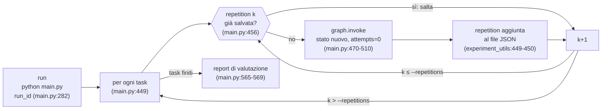
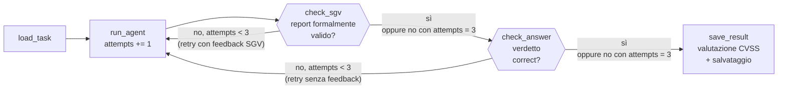

# Pipeline di esecuzione e ciclo dei retry

**Per chi è:** chi deve descrivere il sistema senza averlo mai fatto girare (co-autori di un
articolo, revisori, commissione di tesi). **A cosa serve:** sapere che cosa succede da quando si
lancia `main.py` a quando un risultato è salvato e valutato: quante volte si interroga il
modello, che cosa fa ripartire un tentativo, quando il ciclo si ferma e che cosa si salva.

Fonte: solo il codice. Ogni affermazione porta il suo `file:riga`. Il nome del verificatore
deterministico nel codice è **SGV** (*Syntactic Grounding Verifier*, `utils/sgv.py`); in alcuni
testi esterni lo stesso componente è chiamato SSV.

---

## 1. Perché serve distinguere tre livelli

Un modello linguistico con temperatura maggiore di zero non dà due volte la stessa risposta
(`TEMPERATURE = 0.3`, `config.py:42`). Il sistema deve quindi fare due cose diverse, che si
confondono facilmente: **correggere** una risposta mal formata o insufficiente dentro la stessa
esecuzione, e **ripetere** l'esecuzione da zero per misurare quanto il risultato cambia da una
volta all'altra. A queste due si aggiunge una terza esigenza, pratica: una sessione di lavoro
può interrompersi (timeout, rete, macchina spenta) e deve poter riprendere senza rifare ciò che
è già salvato. Da qui tre livelli annidati, con nomi fissi nel codice.

| Termine | Che cos'è | Dove nasce nel codice | Che cosa lo identifica nei dati salvati |
| :--- | :--- | :--- | :--- |
| **run** | una invocazione di `python main.py` | `run_id`, generato come timestamp UTC se non passato con `--run-id` (`main.py:272-282`) | campo `run_id` di ogni repetition (`utils/experiment_utils.py:406`) |
| **repetition** | un'esecuzione completa e indipendente del grafo su un task: dal caricamento del task al salvataggio | ciclo `for repetition in range(1, args.repetitions + 1)` (`main.py:455`), numero di default `REPETITIONS = 10` (`config.py:47`), sovrascrivibile con `--repetitions` (`main.py:243-248`) | campo `repetition` (`utils/experiment_utils.py:402`) |
| **attempt** | una singola chiamata all'agente LLM dentro una repetition | contatore `attempts`, incrementato a ogni passaggio nel nodo `run_agent` (`utils/experiment_utils.py:257`) | campo `attempts` e lista `history`, un elemento per attempt (`utils/experiment_utils.py:412-413`) |

Un **retry** è un attempt successivo al primo dentro la stessa repetition. Il numero massimo di
attempt per repetition è `MAX_RETRIES = 3` (`config.py:44`, commento: «Max attempts per task
before stopping»): nonostante il nome, la costante conta gli **attempt**, primo compreso. Una
repetition fa quindi al più **un attempt iniziale e due retry** (la condizione di retry è
`attempts < MAX_RETRIES`, `utils/experiment_utils.py:294` e `:476`, valutata dopo che
`run_agent` ha già incrementato il contatore).

*Nell'esempio:* si lancia il task UDR (`task6_vuln_udr_full`) con `--repetitions 10`, quando il
file dei risultati di quell'esperimento contiene già le repetition 1, 2 e 3 salvate da un lancio
precedente. Questo lancio è una nuova run, con il suo `run_id`; esegue le repetition da 4 a 10;
ciascuna di esse fa da uno a tre attempt.

---

## 2. Dalla run alla repetition: che cosa fa `main.py`



*Il contatore delle repetition riparte da 1 per ogni task; una repetition già presente nel file
non viene rieseguita né sovrascritta. Il ciclo degli attempt sta tutto dentro il riquadro
`graph.invoke` ed è descritto nella sezione 3.*

Prima di eseguire qualcosa, `main.py` conta quante repetition mancano e stima il tempo massimo
(`main.py:389-424`). Poi, per ogni task e per ogni numero di repetition da 1 a `--repetitions`,
controlla con `_result_exists` se nel file dei risultati c'è già una repetition con quel numero
(`main.py:455-466`, funzione in `utils/task_utils.py:103-117`). Il file è uno solo per
combinazione di task, experiment-id, ruolo e modello:
`results/rawJson/<task>/<experiment_id>/<ruolo>/<modello>.json`
(`utils/experiment_utils.py:431-439`). Se la repetition c'è, la salta; altrimenti la esegue.
Questo è ciò che rende una run **ripresa** di una run interrotta: rilanciando lo stesso comando
si eseguono solo i numeri mancanti. La conseguenza da tenere presente è che **il numero di
repetition non appartiene alla run ma al file**: un file può contenere repetition prodotte da
run diverse, ciascuna marcata con il proprio `run_id`.

*Nell'esempio:* le repetition 1-3 hanno il `run_id` del lancio precedente, le 4-10 quello del
lancio nuovo; nel file sono un'unica lista di dieci elementi.

Ogni repetition parte da uno stato nuovo: `attempts = 0`, `history` vuota (`main.py:470-483`).
Non c'è memoria fra repetition: l'agente non vede le risposte delle repetition precedenti. La
risposta precedente è tenuta in `main.py` solo per segnalare, a fine run, quali repetition
consecutive hanno dato una risposta diversa (`main.py:537-544`).

L'intera repetition, con tutti i suoi attempt, è sotto un unico limite di tempo:
`TASK_TIMEOUT_SECONDS = 600` secondi (`config.py:49`), raddoppiato per i task il cui nome
contiene `full` (`config.py:52-55`, applicato in `main.py:499-507`). Il limite avvolge
`graph.invoke` (`main.py:508-510`). Se scade nella modalità con i task di `docs/tasks/`, il
programma termina (`main.py:526-527`); nella modalità generica (`--source-dir`) la repetition
viene registrata come non analizzata e si passa alla successiva (`main.py:520-525`). In tutti e
due i casi una repetition interrotta **non lascia nulla su disco**, perché il salvataggio è
l'ultimo nodo del grafo: alla ripresa viene rieseguita da capo.

A fine run, `main.py` rigenera i report di valutazione (`main.py:565-569`). Li calcola su
**tutte** le repetition presenti nei file dei task eseguiti, non solo su quelle della run
appena conclusa: la chiamata non passa il `run_id`. Per limitare un report a una sola run
esiste il comando a parte `python -m utils.evaluation_utils --run-id <id>`, e
`--list-runs` elenca i gruppi (task, experiment, ruolo, `run_id`) con il numero di repetition
(funzioni `_collect_results` e `list_runs` e blocco `__main__` di `utils/evaluation_utils.py`).

---

## 3. Dentro una repetition: il grafo LangGraph e il ciclo dei retry

Il problema che il ciclo risolve è che la prima risposta dell'agente può essere inutilizzabile
per ragioni diverse: un formato che non si riesce a leggere, una funzione citata che non esiste
nel codice, oppure un contenuto che il giudice ritiene insufficiente. Il grafo separa i due tipi
di controllo. Il primo, **SGV**, è deterministico e guarda solo la forma del report. Il secondo,
`check_answer`, giudica il contenuto. Tutti e due possono rimandare all'agente, e consumano lo
stesso contatore.

Il grafo ha cinque nodi (`utils/experiment_utils.py:486-505`):

| Nodo | Funzione | Che cosa fa |
| :--- | :--- | :--- |
| `load_task` | `_load_task` (`utils/task_utils.py:40-95`) | legge il task e il file `_sol.md` (soluzione e rubrica), aggiunge al testo il blocco degli alert SAST se attivo e il blocco di istruzioni CVSS sui task di security review |
| `run_agent` | `_run_agent` (`utils/experiment_utils.py:233-270`) | chiama l'agente; dal secondo attempt in poi usa il prompt di retry; incrementa `attempts`, aggiunge la risposta a `history`, la mette in `final_answer` |
| `check_sgv` | `_check_sgv` (`utils/experiment_utils.py:273-290`) | esegue l'SGV sul blocco CVSS della risposta; solo su task di security review e con `SGV_ENABLED` (`config.py:109`), altrimenti passa sempre |
| `check_answer` | `_check_answer` (`utils/experiment_utils.py:304-367`) | dà il verdetto `correct` / `wrong`: confronto numerico sui task math, giudice LLM con rubrica sui task testuali |
| `save_result` | `_save_result` (`utils/experiment_utils.py:370-472`) | valuta il blocco CVSS contro le CVE note, poi aggiunge la repetition al file JSON |



*Un solo contatore (`attempts`) per i due archi di ritorno: un retry chiesto dall'SGV consuma lo
stesso budget di uno chiesto dal giudice. Quando l'SGV fallisce e ci sono ancora attempt, il
giudice non viene chiamato. Il 3 sugli archi è `MAX_RETRIES` (`config.py:44`).*

### 3.1 Che cosa fa scattare un retry

Le condizioni sono due, e sono le uniche.

1. **L'SGV boccia il report e restano attempt**: `sgv_passed` falso e `attempts < MAX_RETRIES`
   (`_route_after_sgv`, `utils/experiment_utils.py:293-301`). L'SGV (`run_sgv`,
   `utils/sgv.py:176-231`) applica quattro controlli che non usano la ground truth:
   - **G1** forma: la sezione `### CVSS Estimate` esiste, si legge, ha almeno un finding, e ogni
     finding ha `function`, `vector`, `score` e, con `SGV_SNIPPET_ENABLED = True`
     (`config.py:113`), anche `snippet` (`utils/sgv.py:103-123`). Se G1 fallisce, gli altri
     controlli non si eseguono (`utils/sgv.py:185-191`);
   - **G2** esistenza: il nome nel campo `function` compare fra le funzioni Go definite nei
     blocchi ```` ```go ```` del task, cioè nel codice mostrato all'agente, confronto esatto senza
     maiuscole (`utils/sgv.py:51-62`, `:126-133`). Si controlla solo il campo `function`, non
     altri simboli citati nel testo;
   - **G3** aderenza dello snippet: la riga citata è una sottostringa del sorgente, a meno degli
     spazi; altrimenti si accetta se la somiglianza Jaccard sui token con una finestra di una,
     due o tre righe consecutive del sorgente è almeno `SGV_SNIPPET_JACCARD_THRESHOLD = 0.8`
     (`config.py:116`, `utils/sgv.py:89-100`, `:136-158`);
   - **G4** vettore: il vettore CVSS 4.0 ha un valore ammesso per ogni metrica richiesta e lo
     score è numerico (`utils/sgv.py:161-173`).

   Il report passa solo se **tutti** i finding passano G2, G3 e G4 (`utils/sgv.py:223`): un solo
   finding mal formato fa ripartire l'intero report.

   Anche una risposta che non si riesce a leggere finisce qui: se l'output dell'agente non è né
   il Markdown atteso né JSON, viene sostituito da una risposta vuota
   (`agents/agent_runner.py:57-71`), che non ha sezione CVSS e quindi fallisce G1.

2. **Il verdetto non è `correct` e restano attempt**: `verdict != "correct"` e
   `attempts < MAX_RETRIES` (`_route_after_check`, `utils/experiment_utils.py:475-483`). Il
   verdetto si forma così:
   - **task math**: confronto con la ground truth, esatto per gli interi, con tolleranza per i
     reali (`utils/experiment_utils.py:92-122`, `:305-315`);
   - **task testuali**, compresi quelli di security review: un **giudice** LLM (modello
     `MODELS["judge"]`, `config.py:25-29`) assegna un punteggio per ciascun criterio della
     rubrica e un `total_score`; il totale è quello scritto dal giudice, e la somma dei
     criteri si usa solo se manca (`utils/experiment_utils.py:338-344`). Limitato fra 0 e il
     massimo, è diviso per il massimo, e il verdetto è
     `correct` se il rapporto è almeno `TEXTUAL_PASS_RATIO = 0.7`
     (`config.py:51`, `utils/experiment_utils.py:338-352`).

   La rubrica viene dal secondo blocco JSON del file `<task>_sol.md` del task
   (`utils/task_utils.py:73-76`). Sui task di `docs/tasks/` è scritta per quel task e i suoi
   criteri nominano la debolezza attesa (per UDR, ad esempio, `missing_return_score` e
   `regex_validation_score`, massimo 9). Solo nella modalità generica (`--source-dir`) la rubrica
   è quella senza ground truth di `DYNAMIC_RUBRIC_PATH` (`config.py:124`, `main.py:172`), con
   cinque criteri e massimo 10.

   Il giudice riceve il testo del task fino alla sezione `## Agent Instructions` esclusa, cioè
   scenario, **codice sorgente** e domanda; poi la rubrica e le sezioni Answer, Reasoning e
   Confidence della risposta (`agents/judge_agent.py:26-30`, `:63-89`). Non riceve il blocco
   CVSS dell'agente, né la soluzione testuale del `_sol.md`.

*Nell'esempio:* nella repetition 4, al primo attempt l'agente cita una funzione con un nome che
nel file non esiste: G2 fallisce, `attempts` è 1, quindi retry. Al secondo attempt il report è
formalmente valido; il giudice dà 5 punti su 9, rapporto 0,56, sotto 0,7: verdetto `wrong`,
`attempts` è 2, quindi retry. Al terzo attempt il giudice dà di nuovo un punteggio sotto soglia:
`attempts` è 3, non si riparte e la repetition va al salvataggio con verdetto `wrong`.

### 3.2 Che cosa vede l'agente in un retry

Dal secondo attempt il messaggio all'agente è il testo del task seguito da un addendum
(`build_retry_task_content`, `utils/experiment_utils.py:202-230`): l'avviso che il task è già
stato tentato, la risposta, il ragionamento e la confidenza **dell'ultimo** attempt (non di
tutti), e l'invito a ragionare di nuovo da capo. Il system prompt resta lo stesso.

Il contenuto dell'addendum dipende da chi ha chiesto il retry:

- **retry chiesto dall'SGV**: l'addendum contiene anche il feedback formale, un elenco di
  errori per finding nella forma `[funzione] G2: ...` (`utils/sgv.py:218-230`), introdotto da
  un'intestazione che dice che non si tratta di stabilire se il codice è vulnerabile
  (`utils/experiment_utils.py:221-228`). Il feedback non dice mai quale funzione è vulnerabile.
  Il testo degli errori è in italiano, il resto del prompt in inglese;
- **retry chiesto dal verdetto**: l'addendum non contiene né il punteggio né il commento del
  giudice né la ground truth. Quando l'SGV è passato, `sgv_feedback` è vuoto
  (`utils/experiment_utils.py:278`, `:283`) e il blocco formale non viene aggiunto.

La «risposta precedente» mostrata è il campo `answer`; il blocco CVSS dell'attempt precedente
non è ripetuto nell'addendum, perché il parser lo tiene in un campo separato, `cvss_estimate`
(`agents/_llm_utils.py:177-227`, `utils/experiment_utils.py:207`).

### 3.3 Che cosa succede quando gli attempt finiscono

Quando `attempts` arriva a `MAX_RETRIES`, nessuno dei due archi di ritorno è più percorribile.

- Se è l'SGV a fallire all'ultimo attempt, il report va **comunque** al giudice
  (`utils/experiment_utils.py:301`), che dà il suo verdetto.
- Se il verdetto dell'ultimo attempt è `wrong`, la repetition si salva con `verdict = "wrong"`
  (`utils/experiment_utils.py:483`).

In entrambi i casi si salva la risposta **dell'ultimo attempt**, non la migliore fra quelle
prodotte: `final_answer` è sempre l'ultima risposta (`utils/experiment_utils.py:265`) ed è
quella che passa alla valutazione. Che l'ultimo report abbia superato l'SGV o il giudice non è
una condizione per salvarlo né per valutarlo: l'esito dei controlli resta registrato
nell'attempt (`sgv_eval`, `judge_score`, `verdict` dentro `history`,
`utils/experiment_utils.py:285-286`, `:362-364`).

---

## 4. Dopo il ciclo: valutazione contro le CVE note

La valutazione con la ground truth avviene **fuori** dal ciclo, nel nodo `save_result`, quando
la repetition è già conclusa. Sui task di security review della modalità statica,
`evaluate_cvss_estimate` confronta i finding del blocco CVSS con le CVE del dataset
(`utils/experiment_utils.py:382-398`, `utils/cvss_eval.py:274`). L'abbinamento è deterministico
e avviene per nome di funzione: un finding corrisponde a una CVE se il nome della funzione
contiene uno degli handler della CVE o vi è contenuto (`_match_finding`,
`utils/cvss_eval.py:156-175`). Il risultato va in `cvss_eval`, calcolato sull'ultimo attempt;
lo stesso calcolo sul primo attempt va in `cvss_eval_pass1`, per confrontare la detection prima
e dopo i retry (`utils/experiment_utils.py:391-396`). Il codice dichiara che questa valutazione
non influisce sul verdetto (`utils/experiment_utils.py:375`): il verdetto è già stato deciso dal
giudice e il ciclo è già finito, quindi nulla di ciò che si calcola qui torna all'agente.

Nella modalità generica la valutazione contro le CVE non si fa, perché un file qualsiasi non ha
voci nel dataset (`utils/experiment_utils.py:378-386`); a fine run si scrive il report senza
ground truth (`main.py:547-564`).

La repetition salvata contiene, oltre a `repetition` e `run_id`, i tempi, `attempts`,
l'intera `history` (prompt, risposta, esito SGV e giudizio di ogni attempt), `final_answer`,
`verdict`, `judge_score`, `cvss_eval`, `cvss_eval_pass1` e i token
(`utils/experiment_utils.py:400-429`). La configurazione comune (modello dell'agente e del
giudice, temperatura, variante del prompt) è scritta una volta sola, in testa al file, alla
prima repetition (`utils/experiment_utils.py:452-469`).

---

## 5. Parametri che governano la pipeline

| Parametro | Valore | Dove | Effetto |
| :--- | :--- | :--- | :--- |
| `MAX_RETRIES` | 3 | `config.py:44` | attempt massimi per repetition (primo compreso): al più 2 retry |
| `REPETITIONS` | 10 | `config.py:47` | repetition di default per task, e numero che ogni report si aspetta; `--repetitions N` lo sostituisce |
| `TEMPERATURE` | 0.3 | `config.py:42` | agente e giudice (`utils/experiment_utils.py:247`, `:326`); `--temperature` lo sostituisce |
| `TEXTUAL_PASS_RATIO` | 0.7 | `config.py:51` | soglia del rapporto punteggio/massimo per `correct` |
| `TASK_TIMEOUT_SECONDS` | 600 | `config.py:49` | tempo massimo di una repetition intera; `--task-timeout` lo sostituisce, 0 lo toglie |
| `FULL_TASK_TIMEOUT_MULTIPLIER` | 2.0 | `config.py:55` | moltiplica il timeout per i task con `full` nel nome |
| `SGV_ENABLED` | True | `config.py:109` | attiva il nodo `check_sgv` sui task di security review |
| `SGV_SNIPPET_ENABLED` | True | `config.py:113` | chiede lo `snippet` per finding e attiva G3 |
| `SGV_SNIPPET_JACCARD_THRESHOLD` | 0.8 | `config.py:116` | soglia del confronto di riserva di G3 |

Quante chiamate LLM costa una repetition, al massimo: tre all'agente, più una al giudice per
ogni attempt che supera l'SGV o che arriva all'ultimo attempt, quindi al più tre al giudice.
